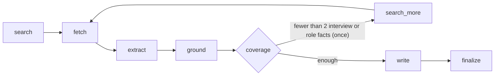

# Interview Brief: a research agent for career coaches

Give it a company, a role and a level. It searches the web and writes an interview-prep brief in which every sentence links to the page it came from.


## Why I built this

I work as a graduate peer career coach at Indiana University. Before every student session I researched the company and the role by hand: what the company does, what the interview loop looks like, what the job actually asks for, what other candidates reported. It took a long time, and it was hard to tell a reliable detail from something a blog made up.

I built this to do that prep for me, and to produce a brief I can trust in front of a student. The rule I designed around: **every fact in the brief is tied to a real source, and the code checks that the source says it.** If the pipeline can't back a sentence with a quote from a page, the sentence doesn't make it into the brief.

## Demo


An excerpt from a real brief (Amazon, Software Developer, new grad), section 2. Each number links to the source:

> **Stage not specified**
> - Candidates report a four-round Amazon SDE-1 loop with two technical rounds, a GenAI round, and a Bar Raiser round, and this newer report supersedes an older report that described three interviews in the loop. [1](https://www.reddit.com/r/leetcode/comments/1u0yzoq/amazon_sde1_interview_experience_2026_4_rounds_2)[2](https://www.reddit.com/r/leetcode/comments/1m7kayb/amazon_2025_software_development_engineer)
> - Candidates report that one first round included Count Inversions, Course Schedule II, and a leadership-principles question about implementing something challenging. [3](https://leetcode.com/discuss/post/6393977/amazon-sde-1-interview-experience-select-ldzi)
> - Candidates report that another second round combined two leadership-principle questions with object-oriented design, and the design prompt was to design a pizza. [4](https://www.reddit.com/r/leetcode/comments/1g6205e/my_amazon_swe1_new_grad_interview_experience)
> - Candidates report that one third round included a variation of LRU Cache and Top K elements, plus a question about critical feedback and improving shortcomings. [4](https://www.reddit.com/r/leetcode/comments/1g6205e/my_amazon_swe1_new_grad_interview_experience)[3](https://leetcode.com/discuss/post/6393977/amazon-sde-1-interview-experience-select-ldzi)

Every brief has the same six sections: TL;DR, company overview and recent news, interview process (grouped by stage), what the role really needs, how to prepare, and questions to ask the interviewer. It ends with the list of cited sources and a line saying how many facts were checked and how many were rejected.

## How it works



The pipeline is a LangGraph graph (`src/graph.py`). Each step prints one line to the log, so a run can be followed step by step.

| Step | What it does |
|---|---|
| **search** | Tavily searches for the company (overview and news), its own careers pages, interview reports (short Reddit and LeetCode queries plus one general query) and the job posting. |
| **fetch** | Full page text through Tavily extract. Long pages are cut to the 6,000 characters most relevant to why the page was chosen. |
| **extract** | One LLM call per source, 4 in parallel. Each call returns facts as JSON, each with an exact quote from the page. |
| **ground** | Code only. A fact is kept only if its quote really appears in the page text. Rejections are logged with a reason. |
| **coverage** | Fewer than 2 interview or role facts triggers one follow-up search for the thin section. |
| **write** | One LLM call. The writer sees only grounded facts (at most 30) and cites them as `[F3]`. |
| **finalize** | Code only. Drops uncited sentences and numbers that aren't in the cited facts, strips leftover labels ("Key Topics:"), labels forum reports and other-level facts, renders the citations as links. |

Every run also writes a debug report: per-source fact counts, every rejected fact with its quote, every dropped sentence and why.

## Key design decisions

**Extract first, then write.** My first version let the LLM write the brief and then had a second LLM check each sentence. It dropped about 58% of sentences: the writer embellished and the checker deleted. Now facts are extracted per source first, and the writer only ever sees facts that passed grounding. The writer can rephrase and combine, but it can't introduce anything new without the finalize step catching the missing citation.

**Grounding is code, not an LLM judge.** A fact survives only if its `exact_quote` appears in the source text (ignoring case, whitespace, punctuation, dash styles and markdown links). Code also rejects facts whose numbers aren't in the quote, time-sensitive claims (valuation, funding, headcount) from undated pages, facts about the publishing site instead of the company, FAQ questions quoted as facts, and dates from one candidate's personal timeline. An LLM judge would be one more thing that can be wrong. A substring check can't be talked into anything, and every rejection has a reason I can read.

**Two models, two reasoning efforts.** Extraction is many small calls, so it runs on Groq's `gpt-oss-20b` at low reasoning effort. Writing is one call that has to follow many rules, so it runs on `gpt-oss-120b` at medium effort and temperature 0. Hidden reasoning is billed as output tokens, so effort matters: on one company page, medium effort spent 3,062 reasoning tokens to find the facts. After I told the extractor what each page is for (company, role or interview), low effort found 12 facts on the same page with about a dozen reasoning tokens per call.

**Provider fallback with a spend cap.** When Groq's free tier hits a daily limit, only the task whose model hit it (extract or write) switches to OpenAI for the rest of the run. OpenAI spend is priced per call and summed in `.cache/spend.json`; past `OPENAI_BUDGET_USD` the run stops with a clear message. All of this lives in `src/llm.py`, the only file that knows about providers, and it is thread-safe because extraction runs in parallel.

**Source types and filters.** Every source is typed: official posting, company site, third-party guide, job aggregator, forum or blog, news. Role facts come from the official posting first. Postings must belong to the company (named in the title or URL), match the requested level ("Engineer I" and "Associate" count as new grad), and be in the requested location. For an intern or new-grad request, a posting whose title says PhD, Senior, Staff, Principal, II/III or a level code, or whose text asks for 3 or more years of experience in any phrasing ("3 years of non-internship experience", "3-5 years") or lists senior duties (mentoring junior engineers, leading code reviews, driving design decisions, owning architecture), is rejected; if no posting is left, section 3 gets labelled general guidance for the role family. A posting that requires another country is rejected even when its footer lists US offices. Interview reports must name the company in the title or URL and match the role family, so a hardware internship post can't stand in for a software one. For an intern or new-grad request, reports about senior candidates are dropped too: the level comes from the title or URL (L4, L5A, SSE, SDE2, SWE II, Senior, Staff) and, for forum and blog posts, from the text itself (3+ years of experience, a level code), so an unlabelled post by an engineer with 5 YOE is no longer new-grad evidence. Glassdoor is never searched or fetched: the project uses search APIs only.

**Choosing the writer's 30 facts.** The writer gets a fixed budget, so the selection matters. Facts are scored by specificity (named problems, topics and questions, numbers, concrete requirements score up; marketing lines score down). Near-duplicates from several sources merge into one fact that cites all of them. At least 3 slots go to candidates' own reports when there are any, because official pages otherwise fill every slot with generic process text.

**Record and replay evals.** Six fixed cases (Google intern, Cummins new-grad SWE, Perplexity AI engineer, Salesforce APM, Amazon new-grad SDE, Uber new-grad SWE) run through the whole pipeline. Recording happens at the Tavily client, so in replay all of my own code runs exactly as it does live and only the network is replaced. Each run prints a table per case, compares it with the previous run and a committed baseline, and fails on regressions. It also warns when the LLM provider differs between runs, because those numbers aren't comparable.

## Results

| | |
|---|---|
| Tests | 518 passing (`pytest`), plus an opt-in test that builds and runs the Docker image |
| Sentences dropped by finalize | 58% in the first design (write, then verify); 4 of 178 (about 2%) across the five baseline briefs |
| Time per brief, uncached | 39 to 112 seconds end to end in the last live recording of the five cases |
| Tokens per brief, uncached | 10k to 32k input, 3.7k to 13k output |
| LLM cost per brief | $0 on Groq's free tier; $0.003 to $0.05 in the last recording, where most extraction ran on the OpenAI fallback |
| Tavily credits per brief | about 9 to 17 (searches, page extracts, and the follow-up search when it runs) |

Eval baseline (`evals/baseline.json`, pinned 2026-10-22; Google re-recorded and Uber added 2026-10-24, all Groq models):

| Case | Interview facts | Role facts | Company facts | Grounded | Rejected | Sentences dropped | Empty sections |
|---|---|---|---|---|---|---|---|
| Google, SWE intern | 40 | 15 | 14 | 77 | 9 | 3 | 0 |
| Cummins, SWE new grad | 2 | 12 | 37 | 51 | 5 | 1 | 0 |
| Perplexity, AI engineer new grad | 17 | 22 | 32 | 78 | 7 | 1 | 0 |
| Salesforce, APM new grad | 10 | 8 | 11 | 30 | 3 | 1 | 0 |
| Amazon, SDE new grad | 53 | 60 | 19 | 136 | 25 | 0 | 0 |
| Uber, SWE new grad | 3 | 31 | 19 | 53 | 2 | 4 | 0 |

Cummins shows the weak spot: there is very little public interview data for it, so the interview section is thin (see Limitations).

## Engineering stories

**The 【F12】 bug.** An early Google brief came out almost empty: 50 sentences checked, 45 dropped as uncited. The writer had cited facts with full-width brackets, `【F12】`, and my checker only recognised `[F12]`. Now every citation style I've seen (`[F1, F2]`, `[F1-F3]`, `(F3)`, `【F3】`, a bare `F3.`) is normalised before checking, and the exact string from that brief is a test case.

**Pages that were all menu.** Careers pages often open with thousands of characters of navigation. The extractor only saw the first 6,000 characters, which were all menu, so it returned no facts. Worse, that empty result was cached by URL and reused forever. Pages are now cut by relevance (text blocks scored with keywords for the page's purpose, menus and headings score nothing), and the cache key includes a hash of the exact text the extractor read.

**Postings from the wrong company.** Siemens' early-career page once became Cummins' job posting, Atlassian's APM page stood in for Salesforce's, and Google's "posting" was a PhD internship that requires living in the UK. Posting selection only checked the level. It now also requires the company in the title, URL or employer line, and rejects postings that require another country.

**A PhD posting in a new-grad brief.** The live Uber new-grad brief built its role section from "Graduate 2026 PhD Software Engineer II (AV Labs)": the word "Graduate" made it look like a new-grad posting. Its interview section also cited reports from L4, L5A and SSE candidates. Senior and PhD markers now win over "Graduate", postings that ask for 3+ years are rejected, and interview sources get their level from the page itself, not just the extractor's label.

**A race in the extraction cache.** After I parallelised extraction, the cache decided which model had answered a call by reading the global settings after the call. If another thread hit Groq's daily limit and switched the run to OpenAI in the meantime, a Groq answer was filed under OpenAI's cache key. Each thread now records which model served its own call, and a test reproduces the exact interleaving with thread events.

## Tech stack

| Area | Tools |
|---|---|
| Language | Python 3.12 |
| Pipeline | LangGraph |
| Search | Tavily search and extract APIs |
| LLMs | Groq (`gpt-oss-20b` for extraction, `gpt-oss-120b` for writing); OpenAI as a fallback |
| API | FastAPI, Uvicorn, SQLite (job queue and store) |
| Web app | Streamlit |
| Tests | pytest, FastAPI TestClient, Streamlit AppTest |
| Deploy | Docker, Render (free web service, `render.yaml`) |

## Run it locally

### Setup
```
python3.12 -m venv .venv && source .venv/bin/activate
pip install -r requirements-dev.txt       # pinned runtime deps + pytest
cp .env.example .env                      # then add TAVILY_API_KEY and GROQ_API_KEY
```

### Command line
```
python src/main.py --company "Amazon" --role "Software Developer" --level new-grad -o brief.md
python src/main.py --company "Stripe" --role "Backend Engineer" --jd "$(cat jd.txt)" -o brief.md
```
`--level` is `intern`, `new-grad` (default) or `experienced`. `--location` defaults to "United States". `--jd` takes a pasted job description, which becomes the top source for the role section. The run report goes to `brief.debug.md`. `--no-cache` redoes fact extraction instead of reading `.cache/extract/`.

### Web app
```
uvicorn --app-dir src --factory api:serve --host 127.0.0.1 --port 8000   # terminal 1: the API
streamlit run app.py                                                     # terminal 2: http://localhost:8501
```
The Streamlit app is a thin client of the API. `POST /briefs` queues a job and returns its id at once, and one background worker runs briefs one at a time. The app shows live progress, then the brief with clickable sources and a markdown download. The same inputs within 7 days return the existing brief instead of running again. Jobs are stored in SQLite and survive a restart.

### Docker
```
docker build -t interview-brief .
set -a; source .env; set +a
export APP_ACCESS_CODE="$(python3 -c 'import secrets; print(secrets.token_urlsafe(24))')"
docker run --rm -p 10000:10000 -e PORT=10000 -e TAVILY_API_KEY -e GROQ_API_KEY -e OPENAI_API_KEY \
  -e FALLBACK_PROVIDER -e FALLBACK_EXTRACT_MODEL -e FALLBACK_WRITE_MODEL -e OPENAI_BUDGET_USD -e APP_ACCESS_CODE \
  interview-brief
```
One container runs both processes. Only Streamlit is exposed; the API listens on `127.0.0.1` inside the container. The image runs in production mode:
- the API refuses to start without an `APP_ACCESS_CODE` of 16 or more characters;
- each browser session sees only its own briefs;
- new briefs are capped per day (`MAX_BRIEFS_PER_DAY`, default 5).

### Deploy (Render, free)
`render.yaml` describes one free web service built from the `Dockerfile`, with Streamlit's health check. In Render: **New, Blueprint**, pick this repo, and enter the four values it asks for (`TAVILY_API_KEY`, `GROQ_API_KEY`, `OPENAI_API_KEY`, and a new `APP_ACCESS_CODE`). Keys live only in Render's environment settings, never in the repo. The free instance has 512 MB of RAM and 0.1 CPU and sleeps after 15 minutes without traffic.

### Configuration
All settings are in `.env` (copy `.env.example`). The main ones:

| Variable | Default | What it does |
|---|---|---|
| `TAVILY_API_KEY`, `GROQ_API_KEY` | (required) | Search and the default LLM provider |
| `OPENAI_API_KEY` | | Needed for the OpenAI fallback or `LLM_PROVIDER=openai` |
| `LLM_PROVIDER` | `groq` | `groq` or `openai` |
| `EXTRACT_MODEL`, `WRITE_MODEL` | `openai/gpt-oss-20b`, `openai/gpt-oss-120b` | Model per task (`LLM_MODEL` sets both) |
| `EXTRACT_REASONING_EFFORT`, `WRITE_REASONING_EFFORT` | `low`, `medium` | For Groq gpt-oss and OpenAI reasoning models |
| `EXTRACT_CONCURRENCY` | 4 | Sources extracted in parallel (1 to 16) |
| `FALLBACK_PROVIDER`, `FALLBACK_EXTRACT_MODEL`, `FALLBACK_WRITE_MODEL` | `openai`, `gpt-5.6-luna`, `gpt-5.4-mini` | Used only after a Groq daily limit |
| `OPENAI_BUDGET_USD` | 3.00 | Stop using the fallback past this tracked spend |
| `APP_ACCESS_CODE` | (blank) | If set, the web app and API require it |
| `MAX_BRIEFS_PER_DAY` | 5 | New briefs per UTC day in the web app (0 = no limit) |

### Tests and evals
```
pytest                                          # 462 tests, no network calls
RUN_DOCKER_TESTS=1 pytest tests/test_deploy.py  # also builds and runs the Docker image (needs Docker)

python evals/run_evals.py --record              # live: records search results and pages to evals/fixtures/
python evals/run_evals.py                       # replay: no Tavily calls; compares with the last run and the baseline
python evals/run_evals.py --from-facts --repeat 3   # writer + finalize only, averaged over 3 runs
```
Recorded fixtures hold third-party page text, so they are gitignored. Only the metrics baseline is committed. Other flags: `--cases a,b`, `--no-cache`, `--no-fail`, `--set-baseline`, `--list`.

## Limitations and roadmap

**Limitations**
- **Free-tier quotas.** Groq's free tier has daily token limits (separate for each model). Tavily's free plan is 1,000 credits a month, about 70 to 100 briefs. The OpenAI fallback costs real money, so I keep a prepaid balance with auto-reload off.
- **Thin data for smaller companies.** Interview reports have to name the company in the title or URL, and many companies have few public reports. Cummins gets 2 interview facts. Reddit pages usually can't be fetched, so only their search snippets are used.
- **No persistent storage on free hosting.** On Render's free tier the disk is wiped when the service sleeps or redeploys. Past briefs, the extraction cache and the daily brief count start from zero, so the daily limit only holds while the service stays awake.
- **Strict grounding.** A slightly altered quote is rejected even when the fact is true. The debug report lists every rejection so I can check.
- **Finalize checks form, not meaning.** It verifies citations, numbers and labels, but it can't catch a sentence that shifts the meaning of a cited fact in plain words.
- **Hand-written heuristics.** Location, level, role family and source type are detected with word lists and regular expressions, and new cases sometimes need new entries.
- **One brief at a time.** The API runs a single worker, because the LLM usage and fallback state are per run.

**Roadmap**
- An external database for jobs and the daily count, so they survive restarts on free hosting.
- More eval cases, especially small companies and roles outside the US.
- Per-coach access instead of one shared code.
- A check that catches a writer sentence which changes the meaning of the fact it cites.
